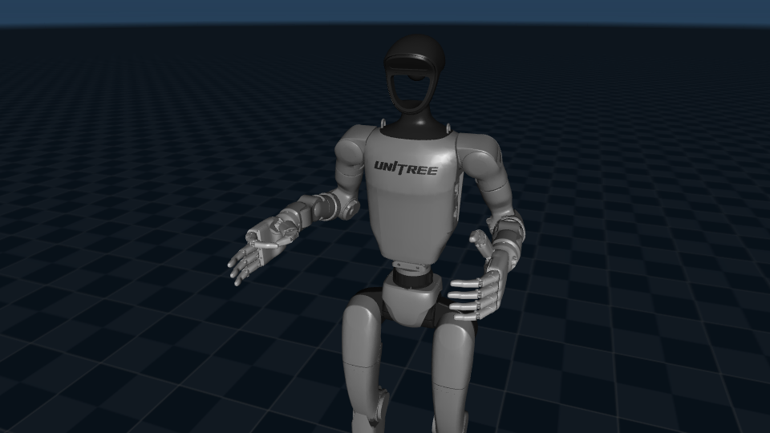

# LiveHand-G1

**Real-time webcam teleoperation of a Unitree G1 humanoid in MuJoCo.**

A laptop webcam tracks both of your hands with MediaPipe. Each robot arm follows your palm, and the G1's 5-finger hands
copy your fingers, including thumb-index pinches. Simulation only: no gloves, no depth camera, no robot hardware.



## Quick start
```bash
.venv-livehand/bin/python -m livehand.tools.camera_check   # check the webcam (fps, hand detection)
.venv-livehand/bin/python -m livehand --vision-only        # camera only: see your hands tracked
.venv-livehand/bin/python -m livehand                      # teleoperation: 5-finger G1, both hands
```
Options: `--hands right`, `--robot dex3` (3-finger Dex3-1 hands, right arm), `--camera 1`, `--camera clip.mp4`
(replay a recording), `--source synthetic` (scripted hands, no camera).

## Controls
Click the camera window so it receives the keys. Calibrate one hand at a time so the other stays on the keyboard:
1. Right hand up in the right half of the image: `n` (neutral), `o` (open), `f` (fist), `p` (pinch).
2. Calibration then moves to the left hand: hold it in the left half, `n`, `o`, `f`, `p`.
3. `s` to save, `e` to start.

| key | action | key | action |
|---|---|---|---|
| `e` | enable / disable teleoperation | `n` `m` `o` `f` `p` | calibrate: neutral, range, open, fist, pinch |
| `SPACE` | emergency stop | `c` | calibrate the other hand |
| `h` | return home | `r` / `g` | palm orientation / fingers on-off |
| `q` | quit | `s` / `l` | save / load calibration |

## How it works
```
webcam -> capture thread -> MediaPipe thread (21 landmarks x 2 hands) -> control loop, per arm:
                                                                           filter -> calibrate -> retarget
                                                                           arm IK (7 joints) + finger targets
MuJoCo physics (500 Hz, real time) <- clamp + rate-limit every actuator <-
```
Palm motion relative to your calibrated neutral is mapped into a bounded workspace around each robot hand; damped
least-squares IK moves each 7-joint arm, and finger curl/pinch blend between gesture poses derived from the robot model.
Vision and physics run independently and only the newest hand state is used. The robot starts disabled and has an
emergency stop, workspace, joint and rate limits, lost-tracking holds and a hand-separation guard.

| `--robot` | model | hands | arms |
|---|---|---|---|
| `inspire` (default) | G1 29-DoF (Unitree URDF) + Inspire RH56DFQ | 5 fingers, 6 actuators each | right + left |
| `dex3` | MuJoCo Menagerie G1 + Dex3-1 | 3 fingers, 7 actuators each | right |

Measured on a Lenovo LOQ 15IRH8 (CPU only): MediaPipe 8.8 ms per frame, ~15 ms capture-to-command; the simulated palm
follows a recorded hand within 1.8 mm (median).

## Project structure
```
livehand/        teleoperation package (python -m livehand)
  tracking.py      camera + MediaPipe threads, two-hand assignment
  features.py      landmarks -> palm position, palm frame, finger curls, pinch
  calibration.py   neutral / range / open / fist / pinch captures
  retarget.py      human -> robot mapping
  arm_ik.py        7-DoF arm IK
  safety.py        limits, watchdog, enable / e-stop
  sim.py           robot models, per-arm controller
  app.py           entry point, windows, keys
  config.toml      all tunable parameters
  tools/           camera_check, replay_check, synthetic_check, pose derivation
  tests/           unit + integration tests
robots/          MuJoCo scene builders (G1 + Inspire, G1 + Dex3-1)
experiments/     scripted grasp and hand-actuation experiments
scripts/         G1 model utilities (viewer, inspection, physics check)
docs/            model notes, experiment write-ups, images
logs/            results of checks and experiments
```

## Setup
```bash
git clone git@github.com:Greninja44/livehand-g1.git && cd livehand-g1

# robot models (git-ignored)
git clone https://github.com/google-deepmind/mujoco_menagerie.git models/mujoco_menagerie
git -C models/mujoco_menagerie checkout f3b6013629c7b94f8ee93fd977b161fa8350f9bc
git -C models/mujoco_menagerie sparse-checkout set unitree_g1
git clone --depth 1 --filter=blob:none --sparse https://github.com/unitreerobotics/unitree_ros.git models/unitree_ros_probe/src
git -C models/unitree_ros_probe/src sparse-checkout set robots/g1_description

# teleoperation environment + MediaPipe hand model
python3 -m venv .venv-livehand && .venv-livehand/bin/pip install -r requirements-livehand.txt
mkdir -p livehand/models && curl -fsSL -o livehand/models/hand_landmarker.task \
  https://storage.googleapis.com/mediapipe-models/hand_landmarker/hand_landmarker/float16/latest/hand_landmarker.task

# optional: environment for experiments/ and scripts/
python3 -m venv .venv && .venv/bin/pip install -r requirements.txt
```
Pinned versions (MuJoCo 3.17.0, MediaPipe 1.2.0, OpenCV 5.0, NumPy 2.5) support Python 3.14. Tested on Ubuntu 26.04.

## Tests
```bash
.venv-livehand/bin/python -m unittest livehand.tests.test_core      # 48 tests, no camera or display needed
.venv-livehand/bin/python -m livehand.tools.synthetic_check        # real-time end-to-end check
```

## Credits
Unitree G1 models from [MuJoCo Menagerie](https://github.com/google-deepmind/mujoco_menagerie) and
[unitree_ros](https://github.com/unitreerobotics/unitree_ros) (BSD-3-Clause, Unitree Robotics);
[MediaPipe](https://github.com/google-ai-edge/mediapipe) and [MuJoCo](https://github.com/google-deepmind/mujoco)
(Apache-2.0). The models are downloaded during setup, not redistributed.
